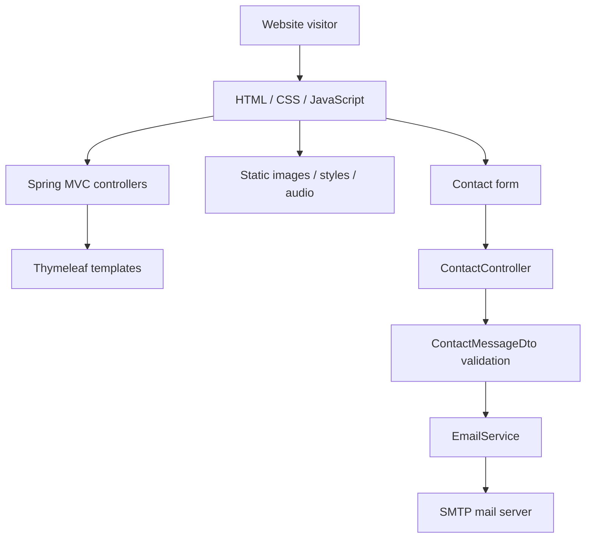

<div align="center">

# DJ DMT & DJ Julien — DJ Website

### A music and events showcase built with Java, Spring Boot, and Thymeleaf

A responsive, Bulgarian-language website for presenting a DJ duo, showcasing event services and music, and handling booking enquiries through an email-powered contact form.


**[Features](#features)** · **[Tech stack](#tech-stack)** · **[Getting started](#getting-started)** · **[Project structure](#project-structure)** · **[Routes](#routes)**

</div>

---

## Overview

**Djs-Site** is a Java web application designed as an online presence for DJs **Daniel Tenev** and **Julien Limberov**. It combines promotional event content, music playback, a fan/merchandise section, and an enquiry form in a single website.

Rather than relying on a separate single-page application, the project uses **Spring MVC controllers** to serve **Thymeleaf/HTML views**, while CSS and JavaScript handle the visual experience and interactive elements.

The interface is primarily written in **Bulgarian**, targeting visitors looking for DJ services for celebrations and events.

## Features

### Event and DJ presentation

- Landing page with a hero section introducing the DJ service.
- Promotional event categories, including weddings, graduation parties, company events, birthdays, jubilees, and reunions.
- About page presenting both DJs.
- Responsive navigation and layouts for desktop and mobile screens.
- Links to the duo's social-media profiles.

### Music showcase

- Dedicated music and episodes pages.
- Embedded **jPlayer** playback for MP3 audio hosted in the application's static resources.
- Player controls, progress display, and a download link for a sample track.
- Music-related layouts and media assets for the website's visual presentation.

### Fan zone and promotional content

- Fan-zone page featuring DJ merchandise presentation.
- Additional pages/layouts for news and promotional updates.

> **Implementation note:** The news page contains a submission interface, but the checked-in Spring MVC code does **not** implement a corresponding publishing endpoint or database-backed news management. It is a front-end page rather than a working content management system.

### Contact and booking enquiries

The `/contact` page includes a server-side form powered by:

- **Spring MVC** form handling and Thymeleaf bindings.
- **Jakarta Bean Validation** for user input.
- **Spring Mail / `JavaMailSender`** for sending enquiry emails over SMTP.
- Redirect messages for successful or failed email submission.

Validated fields include:

| Field | Validation |
| --- | --- |
| Name | Required, 2–50 characters |
| Email | Required, valid email format |
| Phone | Optional, maximum 15 characters |
| Message | Required, 10–2,000 characters |

## Tech stack

| Area | Technology |
| --- | --- |
| Language | Java 17 |
| Framework | Spring Boot 3.3.0, Spring MVC |
| Server-rendered views | Thymeleaf |
| Forms and validation | Jakarta Bean Validation / Spring Validation |
| Email delivery | Spring Boot Mail, JavaMailSender, SMTP |
| Frontend | HTML, CSS, JavaScript, Bootstrap, jQuery |
| Media playback | jPlayer |
| UI utilities | SlickNav, Magnific Popup, Font Awesome, MixItUp |
| Build | Gradle Wrapper |

The current implementation does **not** require a database for its existing pages or contact form.

## Application architecture



The application follows a straightforward MVC structure:

1. A browser requests a page such as `/`, `/about`, or `/music`.
2. A Spring controller selects the corresponding Thymeleaf template.
3. Static CSS, JavaScript, images, and audio are served from `src/main/resources/static/`.
4. Contact submissions are validated on the server and forwarded to the email service.

## Routes

| Method | Path | Purpose |
| --- | --- | --- |
| `GET` | `/` | Home / promotional landing page |
| `GET` | `/about` | DJ profiles and background |
| `GET` | `/music` | Music showcase |
| `GET` | `/episodes` | Additional music/episodes view |
| `GET` | `/fan-zone` | Merchandise/fan-zone presentation |
| `GET` | `/news` | News submission UI (presentation only) |
| `GET` | `/contact` | Contact form |
| `POST` | `/contact` | Validate and email a contact enquiry |

> There is no separate REST API for managing songs, news, bookings, or merchandise in the checked-in implementation.

## Getting started

### Requirements

- **JDK 17** or newer compatible JDK.
- A terminal or IDE with Java support.
- An SMTP account if you want to test the contact form's email-delivery functionality.

The **Gradle Wrapper** is included, so a separate Gradle installation is not necessary.

### 1. Clone the repository

```bash
git clone https://github.com/RosenTodorov2006/Djs-Site.git
cd Djs-Site
```

### 2. Configure email safely

The checked-in `src/main/resources/application.properties` contains Gmail SMTP settings, while `EmailServiceImpl` currently uses fixed sender and recipient addresses.

**Before running or deploying the contact form, remove any committed SMTP credentials, rotate the exposed password, and use environment variables.** A safer example configuration is:

```properties
spring.mail.host=smtp.gmail.com
spring.mail.port=587
spring.mail.username=${MAIL_USERNAME}
spring.mail.password=${MAIL_PASSWORD}
spring.mail.properties.mail.smtp.auth=true
spring.mail.properties.mail.smtp.starttls.enable=true
```

For a local terminal, configure the appropriate variables without committing them to Git. For example, in PowerShell:

```powershell
$env:MAIL_USERNAME="your-smtp-account@example.com"
$env:MAIL_PASSWORD="your-app-password"
```

Also update the hard-coded sender and recipient addresses in `EmailServiceImpl` for your own deployment. A verified SMTP setup is required only for delivering contact messages; the website's public pages can be viewed without sending mail.

### 3. Run the application

On Windows:

```powershell
.\gradlew.bat bootRun
```

On macOS/Linux:

```bash
./gradlew bootRun
```

Then open **http://localhost:8080** in a browser (assuming the default Spring Boot port is available).

### 4. Build a runnable JAR

```bash
./gradlew bootJar
```

The generated JAR is placed under `build/libs/`.

## Project structure

```text
Djs-Site/
├── build.gradle
├── gradlew / gradlew.bat
├── settings.gradle
└── src/main/
    ├── java/org/example/
    │   ├── DjAppRunner.java
    │   ├── controllers/
    │   │   ├── HomeController.java
    │   │   ├── AboutController.java
    │   │   ├── MusicController.java
    │   │   ├── EpisodesController.java
    │   │   ├── FanZoneController.java
    │   │   ├── NewsController.java
    │   │   └── ContactController.java
    │   ├── models/dtos/
    │   │   └── ContactMessageDto.java
    │   └── services/
    │       ├── EmailService.java
    │       └── impl/EmailServiceImpl.java
    └── resources/
        ├── application.properties
        ├── templates/
        │   ├── index.html
        │   ├── about.html
        │   ├── music.html
        │   ├── episodes.html
        │   ├── fan-zone.html
        │   ├── news.html
        │   └── contact.html
        └── static/
            ├── css/
            ├── js/
            ├── img/
            ├── music-files/
            ├── sass/
            └── fonts/ and other bundled assets
```

## UI and styling

The frontend uses a customized **Megapod** music-oriented theme (the included theme JavaScript credits **Colorlib**), alongside additional styling and content for the DJ duo. Features include:

- Responsive mobile navigation with SlickNav.
- Image-backed promotional sections and layout styling.
- Font Awesome iconography and social links.
- Audio controls provided through jPlayer.

The source repository contains bundled third-party libraries, theme assets, images, and MP3s. **Verify the licensing and distribution rights for all reused media and templates before republishing or commercially deploying the project.**

## Current limitations and improvements

This repository is primarily a **promotional website**, not a full event-booking or music publishing platform. Potential next steps include:

- [ ] **Security:** revoke the exposed SMTP password, remove secrets from tracked files and Git history, and use environment-based configuration.
- [ ] Make sender and recipient email addresses configurable instead of hard-coded.
- [ ] Add spam protection and rate limiting to the public contact form.
- [ ] Implement proper news publication storage and server-side submission handling.
- [ ] Add an admin dashboard to manage tracks, updates, and event content.
- [ ] Introduce automated tests for controllers, form validation, and email-service behavior.
- [ ] Extract shared header/footer markup into reusable Thymeleaf fragments.
- [ ] Remove unused or duplicate Gradle dependencies and review bundled static assets.
- [ ] Review accessibility, SEO metadata, and third-party asset licenses.

## Author

Developed by **[Rosen Todorov](https://github.com/RosenTodorov2006)** as a Java / Spring Boot project combining server-rendered web development, interactive frontend media, and email-based contact functionality.

---

*This README describes the implementation currently checked into the repository. Proposed enhancements are listed separately from working features.*
